# (已更新至0.3.7) CC98 Reborn | 一个重构网页版CC98 UI的插件

【依旧观前预警】：本项目含有98.98%的Vibe Coding成分！

本项目仍存在不少bug，并非稳定，还请uu们多多包容、多提意见呀。

这个vibe coding项目是lz心血来潮做的，最初目的是满足lz对极简界面的一些追求（？）后来一边自己用，一边跟着大家的反馈继续缝，慢慢加了一些读帖、写帖和整理资料的小功能。

目前更新到0.3.7。主要目标还是重构和统一网页版98的视觉界面，改善帖子阅读、发帖回复、个人中心、消息中心这些日常页面的使用体验。下面把已有功能和这几版新加的东西一起重新介绍一下。

## 先把界面收拾一下

### 统一的论坛界面

最开始就是想让98看起来更清爽一点（？）所以把首页、版面、帖子、搜索、个人中心、消息中心和编辑页都重新收拾了一遍。常用操作还是尽量沿用原站的逻辑，换了个壳，日常该怎么用还是怎么用。

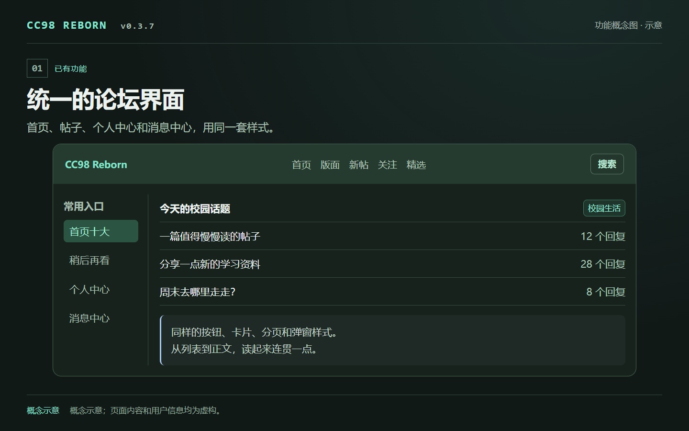

### 明暗、配色，分开选

这次把明暗和配色拆开了：白昼、黑夜、自动单独选，再挑主色和副色，颜色会用在论坛页面上的各种元素里。嫌预设不够的话也可以自己调。自动模式默认早上7点变亮、晚上7点变暗，时间可以改，切换时不会把正在写的东西清掉。

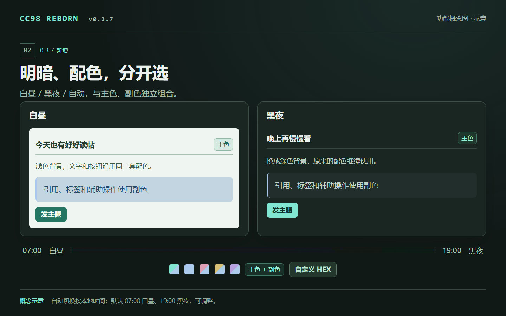

### 复古 ASCII 风格（实验性）

另外缝了一套复古ASCII风格：字符边框、等宽字、紧凑列表，按钮也尽量用文字标记。它不是换个颜色，而是整套排版一起换；依旧可以选明暗和主色、副色。目前还在慢慢补适配，先挂个实验性标记呀。

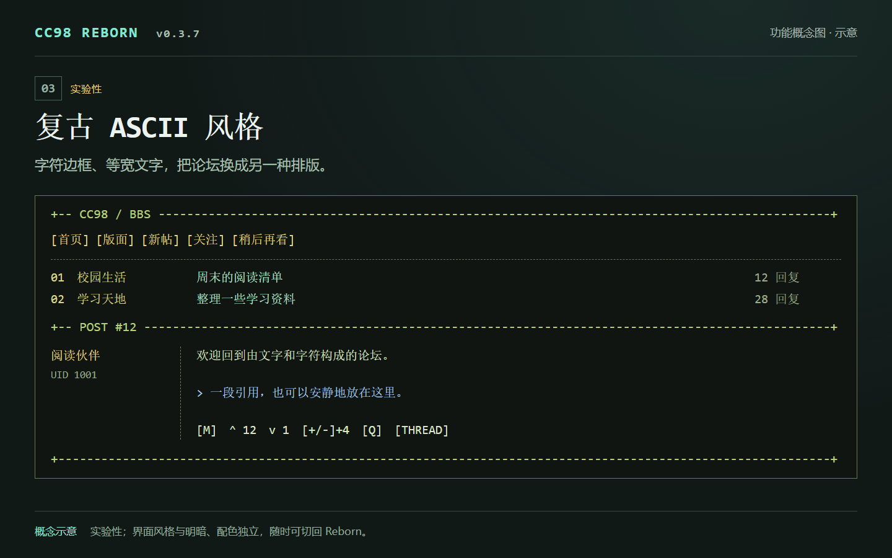

### 常逛的版面，放近一点

常逛的版面可以自己置顶，省得每次重新翻目录。也可以把导航换到左侧效率栏，给正文多留一点位置。这两项都可以按自己的使用习惯开关。

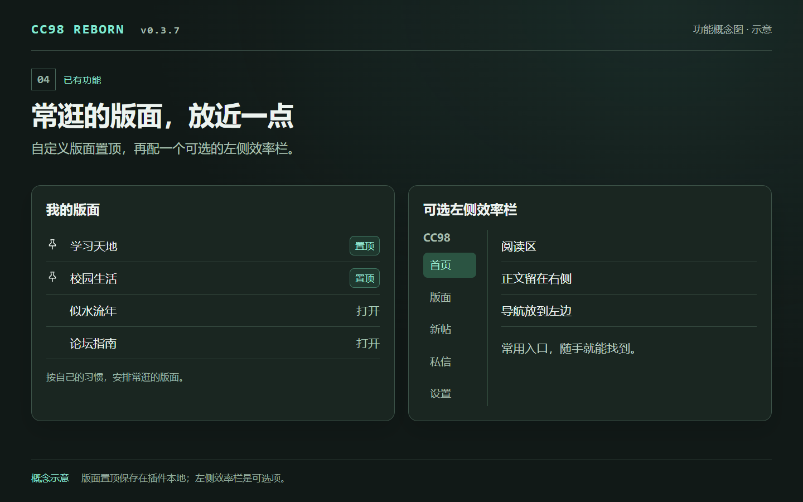

### 十大排名，能看见变化

首页可以只留十大，读起来更干净；和上一次记录相比，排名上升、下降也会有个小提示。不是实时盯着服务器跑，变化是根据本地已有记录对比出来的。

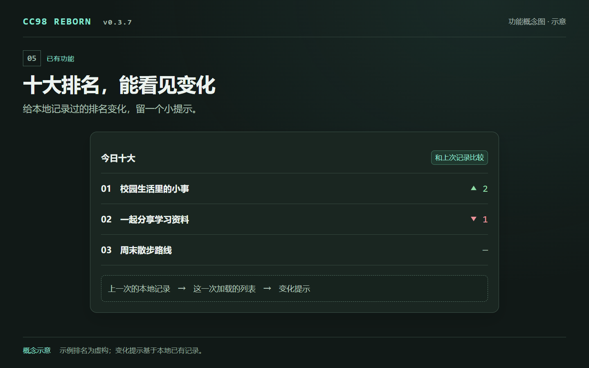

## 阅读时少来回折腾

### 本地分析的搜索联想

搜索联想仍然是纯本地分析的小工具，没有接外部AI。支持主题、用户、版面等搜索入口，也有按账号保存的搜索历史；结果可以按原顺序、时间或者浏览量排。联想可能有点粗糙，uu们先凑合用（？）

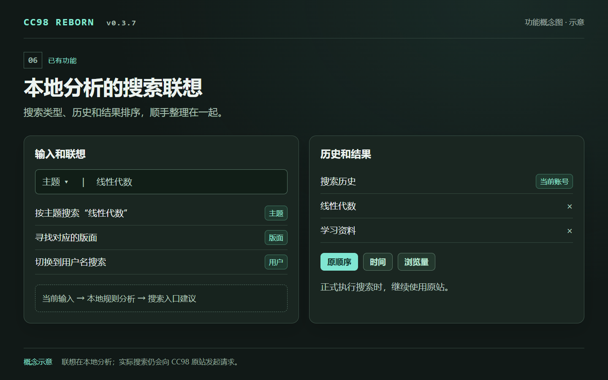

### 独立的稍后再看

看到想读的帖子但现在没空，就先丢进稍后再看。它和原站收藏是分开的，有自己的搜索、已读状态、导入和导出；列表页旁边也能直接打开，省得读完一篇就找不到下一篇。

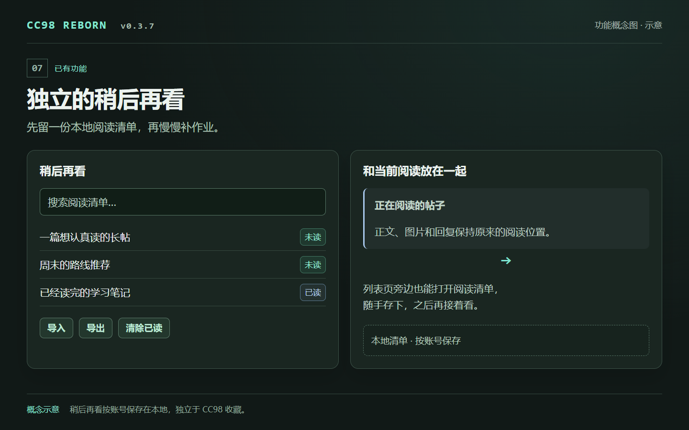

### 把一段对话放在一起

新增了“查看对话”：从一层出发，把它引用了谁、后面又被谁引用，尽量在一个窗口里串起来。每一级会跟在父引用下面缩进，图片和表情也能一起看。需要时会静默读取其他页，前台页面和草稿不动；读过的页会暂存，再看本帖其他对话时就不用重读一遍了。

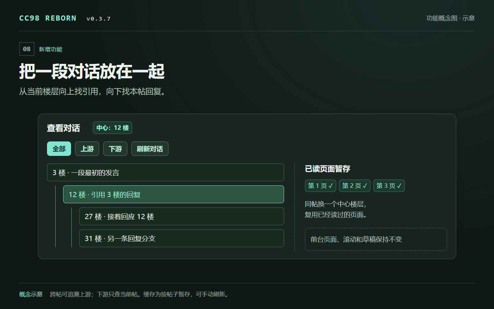

### 更顺手的图片阅读器

图片点开后可以拖拽移动、滚轮缩放，也能用左右键切换和保存。长图、小字图终于不用反复新开一堆标签页了。

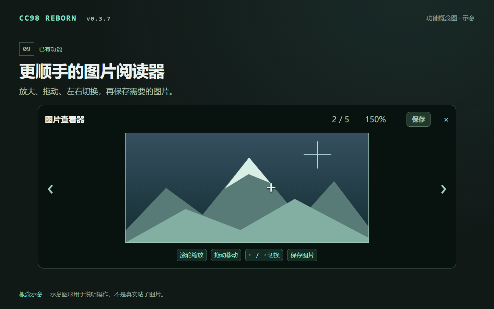

### 图片和媒体，补齐适配

图片懒加载、引用里残留的图片标记，这几版都继续修了一轮；音频、视频和文件下载也重新做了适配。下载文件可以直接呼出浏览器下载，隐藏图片仍然要自己点开，不会顺手替uu展开。

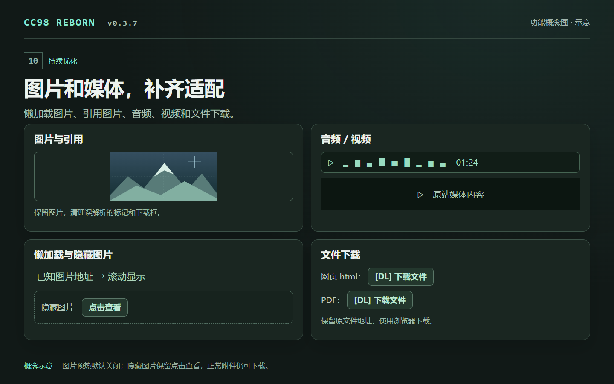

### 楼层操作和风评记录

楼层下面那排按钮也收拾了：赞、踩合成左右一颗胶囊，其他常用操作换成图标，悬停仍能看说明。评分和评分记录旁会显示带正负号的风评数字，正负颜色统一，不用自己心算啦。

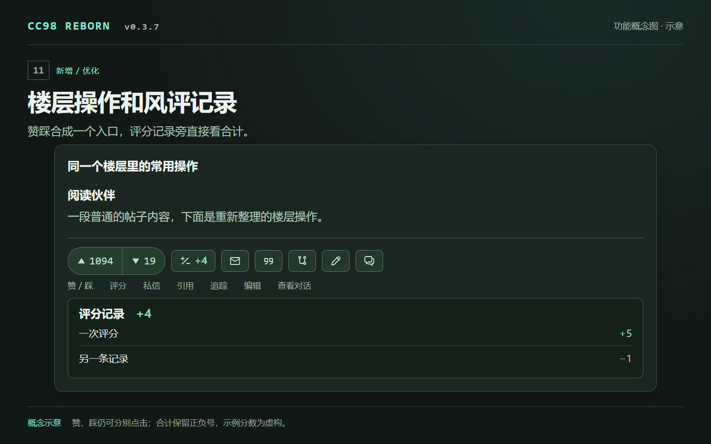

## 把自己的东西整理好

### 分享一整个收藏夹

想分享一整组好帖的话，不用一条条复制链接了。收藏分组可以导出成一段字符串；别人贴给你的分享串也能先解码预览，再选自己的目标分组导入。已有收藏会跳过，支持停止、继续和失败重试。

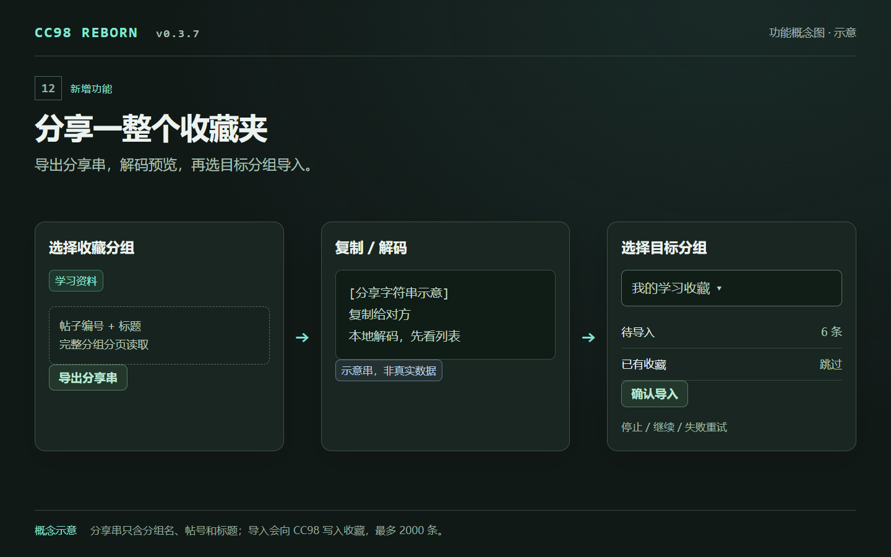

### 给用户留个自己的备注

老是记不住用户名的uu，可以给对方加个只有自己能看到的备注。关注列表和用户主页都能改，帖子作者旁边也会带出来；原用户名保留，备注跟着UID走，对方改名也不会丢。

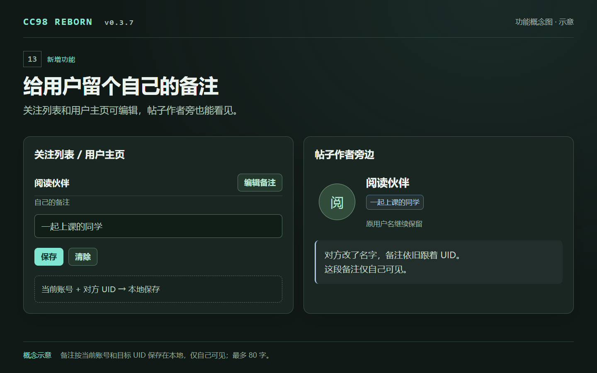

### 常聊的人，私信置顶

近期私信列表加了置顶。常聊的人可以留在前面，不用每次从一长串联系人里翻；切换会话、未读状态和正在写的私信，还是沿用原站的行为。

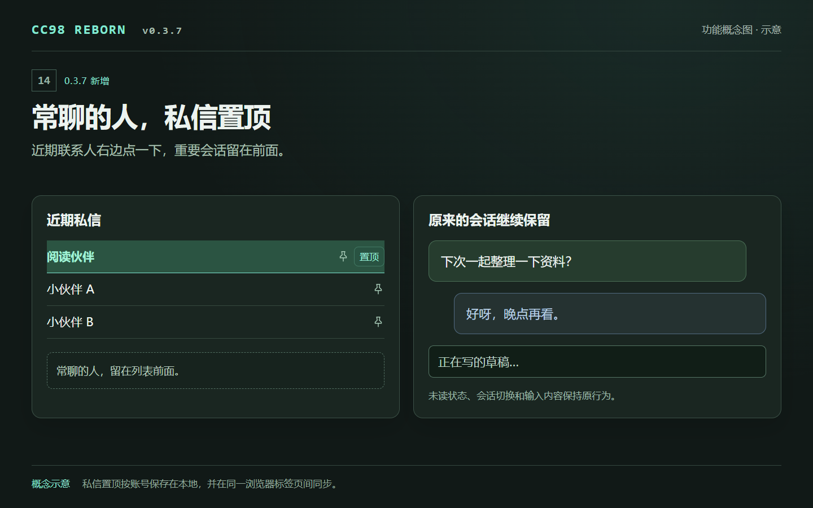

### 私信也好好收拾一下

私信的表情和快捷UBB入口也保留着，这次又把表情尺寸、近期联系人排版和消息分页收了一遍。暗色下ac系列会做反色处理——毕竟ac娘是透明的呀。普通图片不会跟着表情一起缩小。

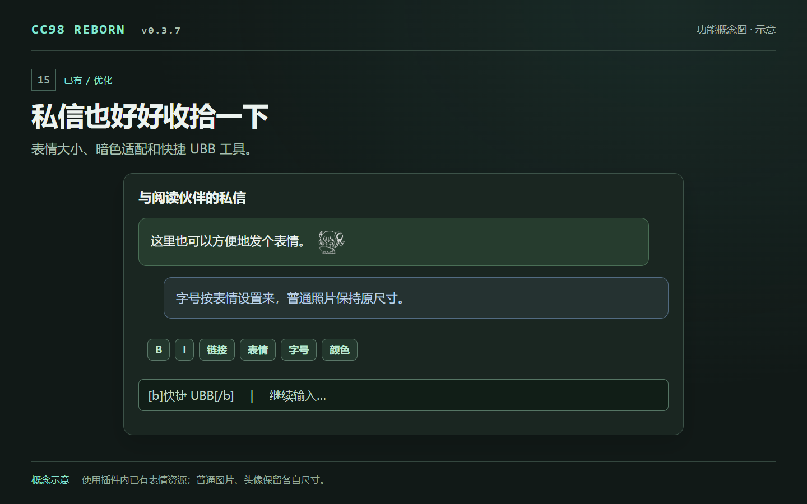

### 个人中心也有插件设置

不想每次找浏览器右上角的话，现在可以直接进个人中心最底下的“插件设置”。这里包含popup里的全部内容，两处用的是同一份设置，改完会同步。

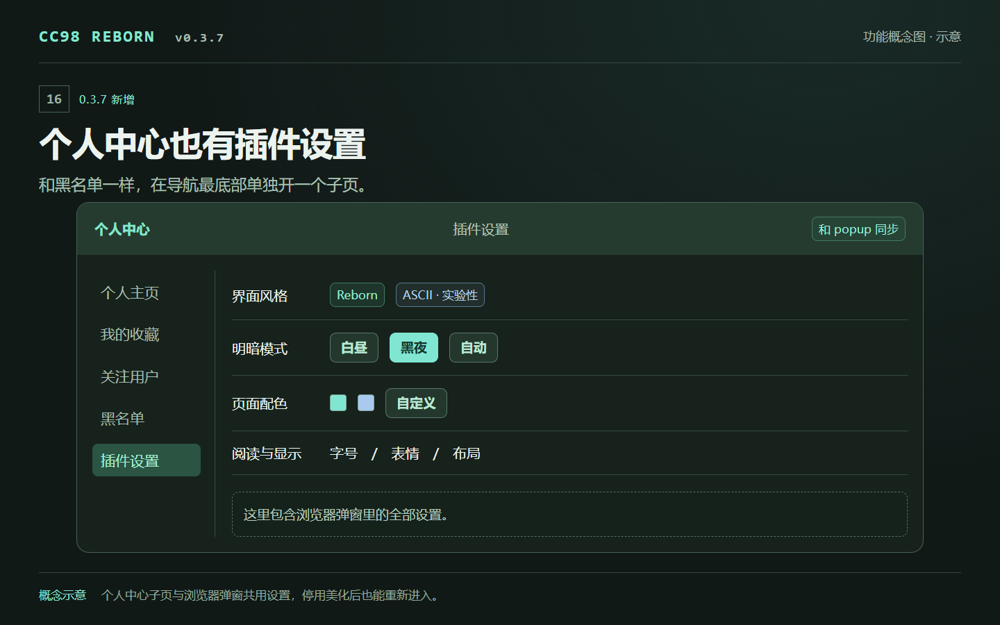

### 个人配置，备份一份

设置最底下加了备份和导入。主题、阅读显示、黑名单、用户备注、私信置顶、版面置顶都可以留一份；换环境时先看导入预览，再恢复。登录凭证、密钥、草稿和稍后再看不混在这份备份里。

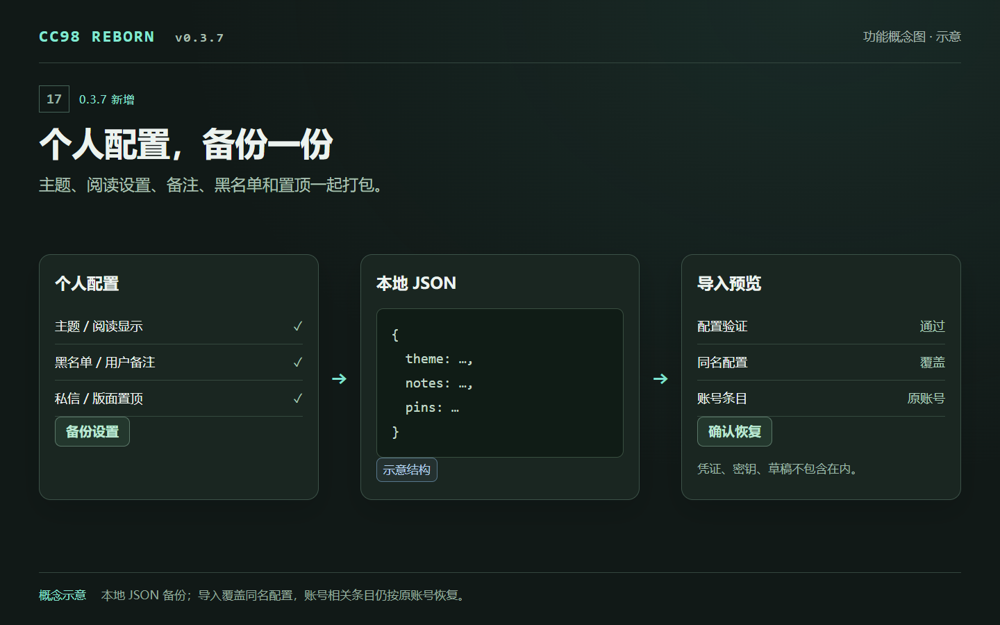

## 写东西时，也少折腾一点

### 上下都能写的双区编辑器

UBB编辑器还是上下双区：上面直接改渲染后的内容，下面改带高亮和行号的源码，两边同步。可以拖分隔线调整空间，也留了“同步”和“旧预览”作为备用。表格里只移动光标再粘贴时跑到旧单元格的问题，也已经修了一轮。

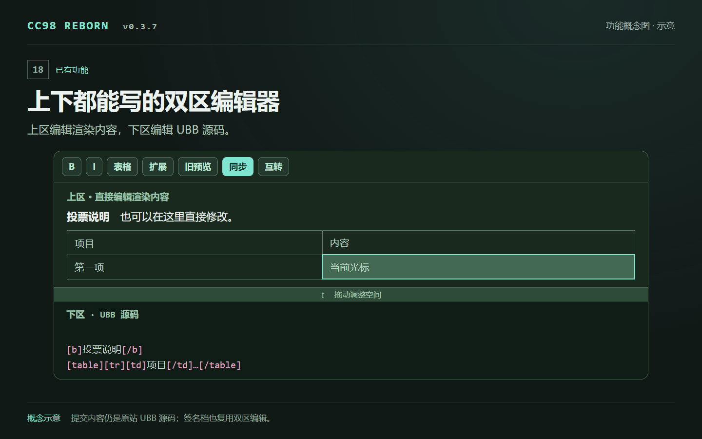

### 扩展语法，放进工具栏（实验性）

工具栏的“扩展”里能插引用、代码块、Markdown、数学公式、原样文本、字体、表格和折叠图片。表格支持1到6行列，复杂格式可以在上区看着改。高级语法仍有实验性，遇到奇怪的组合欢迎把例子丢给lz。

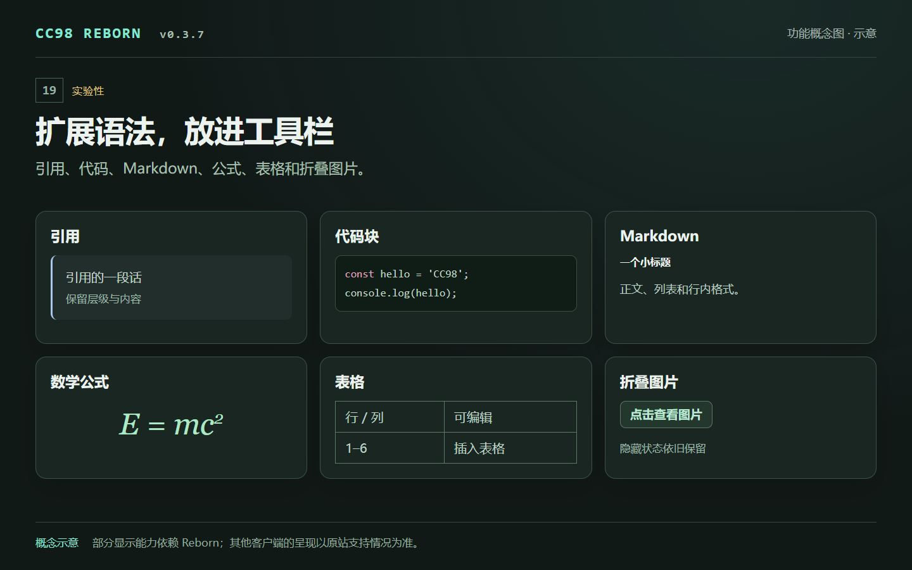

### UBB 与 Markdown 互转（实验性）

“互转”可以把常见UBB和Markdown格式来回转，先预览再手动替换。两边语法毕竟不完全一样，不能等价转换的会提示；回复可见这类权限内容也不会让它直接替换。

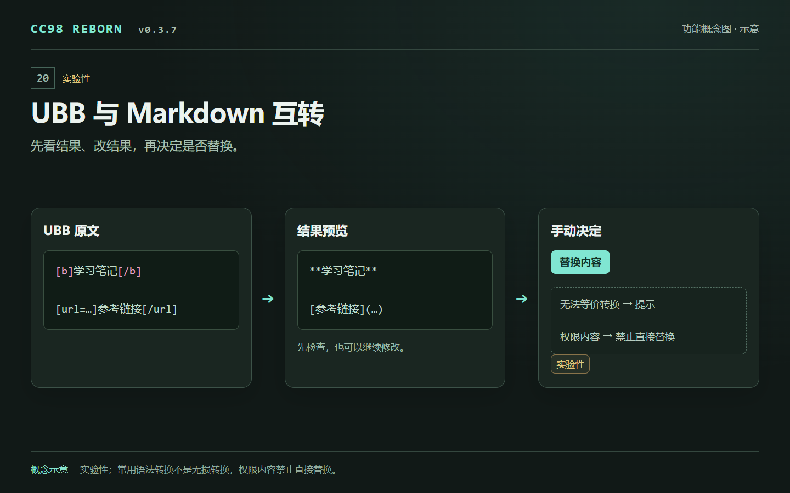

### 发投票，也接上新界面

版面上的“发投票”也接上统一样式了。有效天数、最多可投数量、投票后结果可见和选项增删都保留原站规则，可以继续用UBB或Markdown写说明。投票主题的标题、正文草稿会和普通主题分开存。

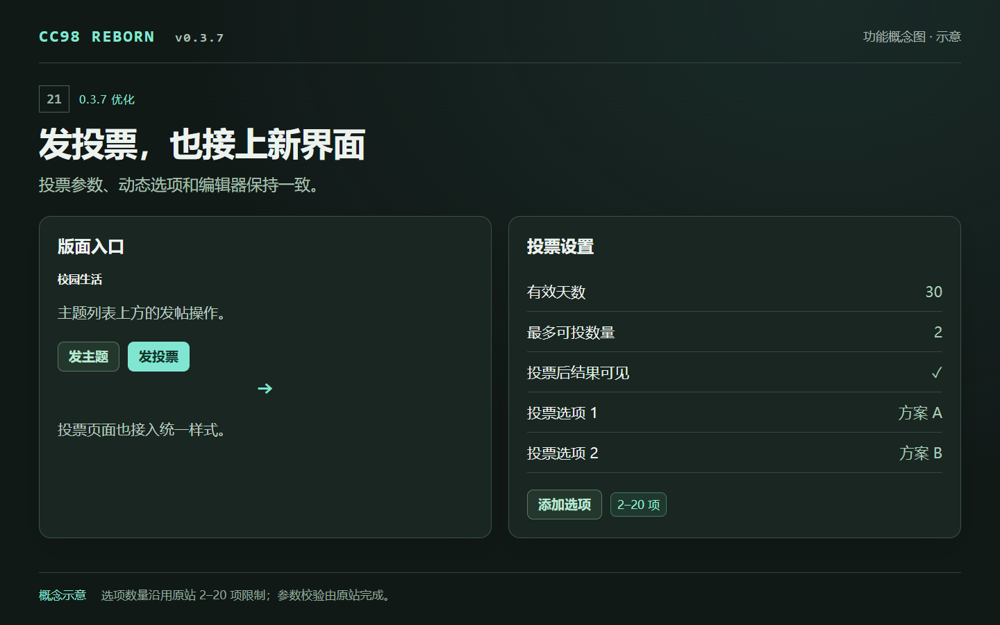

## 还有一些小工具

### 本地屏蔽规则

不想在自己的列表里看到的版面、标题关键词和UID，可以在插件里设置屏蔽。它处理的是自己的阅读界面，不会替你改别人的帖子。

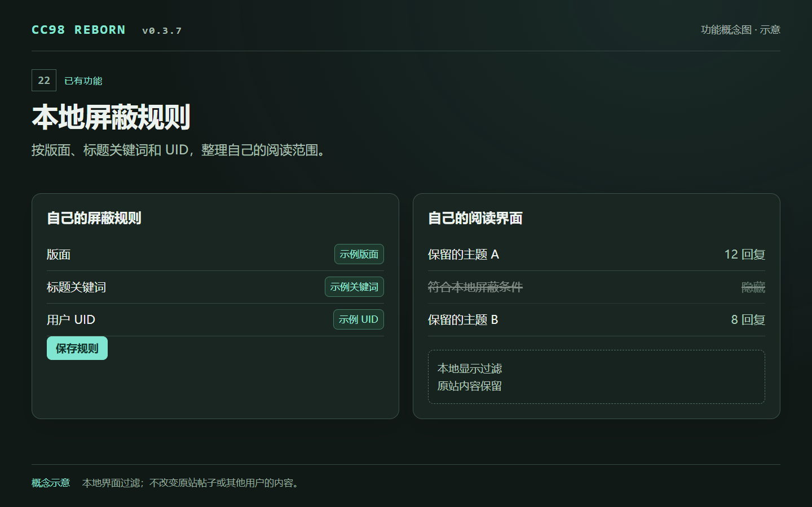

### 更新检查和数据清理

插件里可以手动或定时检查GitHub Releases的新版本。缓存异常时也留了明确的CC98站点数据清理入口，是否清理由uu自己决定，清完可能需要重新登录呀。

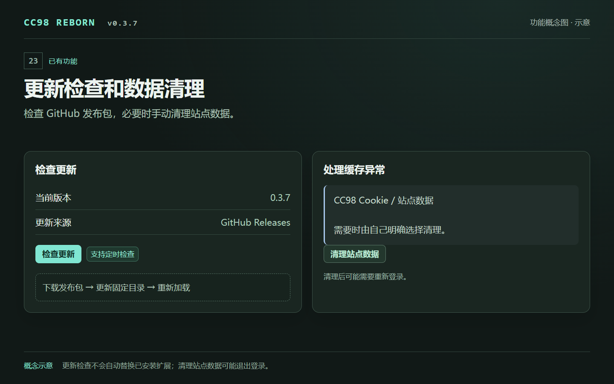

### 问号键，继续做实验（实验性）

问号键也还在，默认关闭。想试的话，要先看独立隐私说明，再用同一个CC98账号授权。它用的是独立服务，会传输授权信息和帖号、楼层号；目前只验证了直连授权，WebVPN这部分还没有接上。

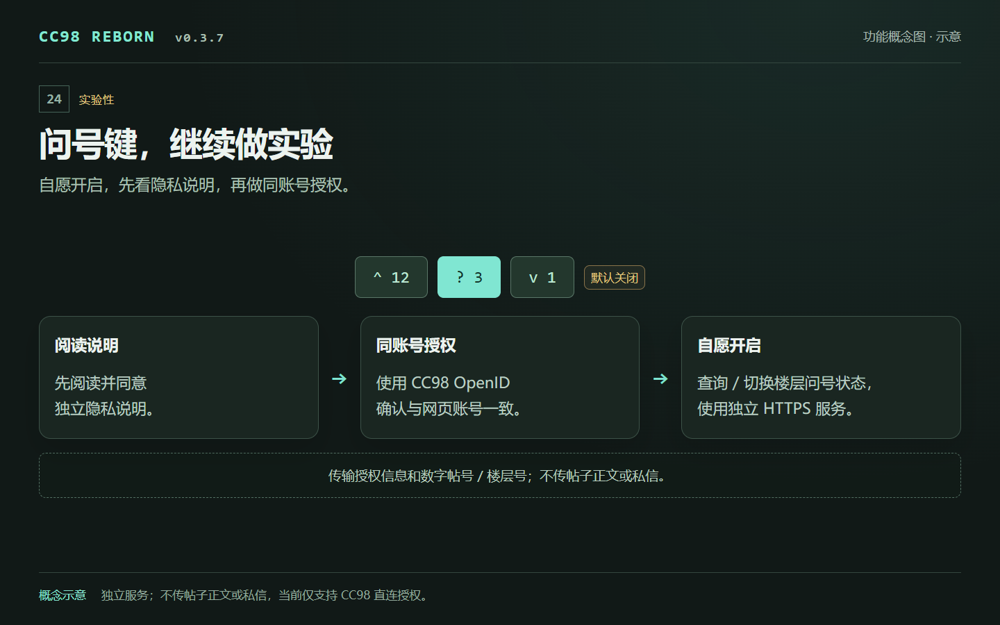

## 关于本地数据和联网

页面重构、本地搜索联想、备注和个人配置，主要在浏览器本地处理。查看对话会按需读取原帖的分页，收藏导入会向CC98提交收藏请求；读过的分页会暂存，也可以停止读取。

另外，现在不能再笼统说“没有任何信息外传”了：CC98 OpenID绑定需要和官方授权服务通信，更新检查会访问GitHub；可选的问号键还会使用独立服务，传输授权用的ID Token、数字帖号和楼层号，不传帖子正文、图片或私信。问号默认关闭，使用前会要求阅读独立隐私说明。

本地功能也不等于自动跨设备同步。用户备注和置顶等配置默认保存在当前浏览器；个人设置可以自己备份，稍后再看有独立的导入导出。

插件发布页在这里！

[GitHub Releases](https://github.com/Coran-tech/cc98-reborn/releases)

喜欢的话别忘给lz点个Star呀。遇到问题可以回帖，或者去[GitHub Issues](https://github.com/Coran-tech/cc98-reborn/issues)留个例子；带上插件版本、直连还是WebVPN、发生在哪个页面，会方便lz定位一点。

## 食用方法

1. 前往GitHub Releases下载最新版本压缩包，解压到一个固定文件夹。注意：安装后不要随意删除或移动这个文件夹。

2. 打开Edge的edge://extensions/，或者Chrome的chrome://extensions/，开启“开发人员模式”，点击“加载解压缩的扩展”，选择刚才解压出来的插件文件夹。

3. 安装完成后，从浏览器右上角的拼图按钮打开CC98 Reborn，检查插件开关，再打开CC98。个人中心最底下也能找到“插件设置”。需要OpenID绑定的功能，按插件提示使用与网页一致的CC98账号授权。

4. 升级时用新版本文件更新固定文件夹，再到扩展管理页点“重新加载”，然后刷新论坛页面。升级前也可以先备份一份自己的配置。

